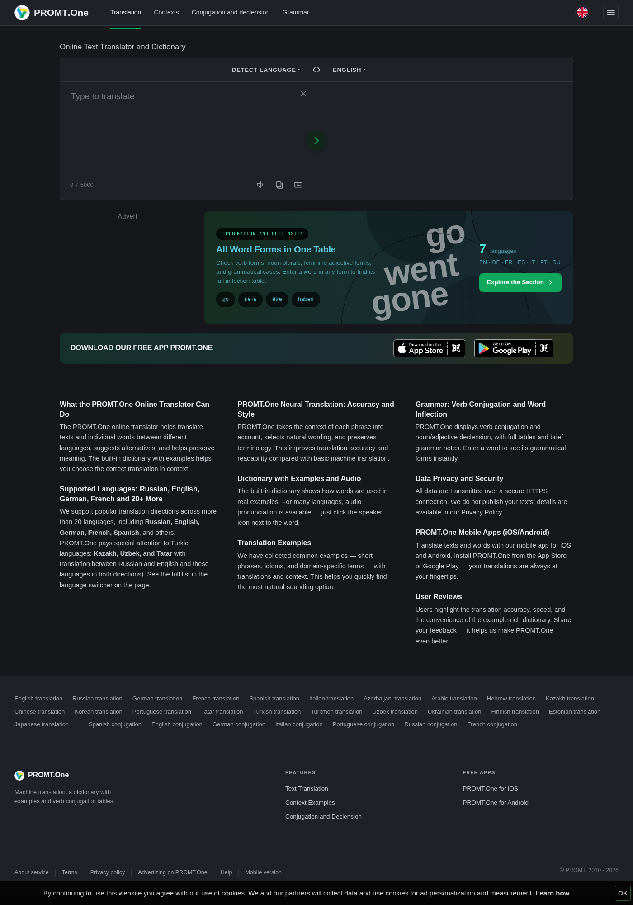
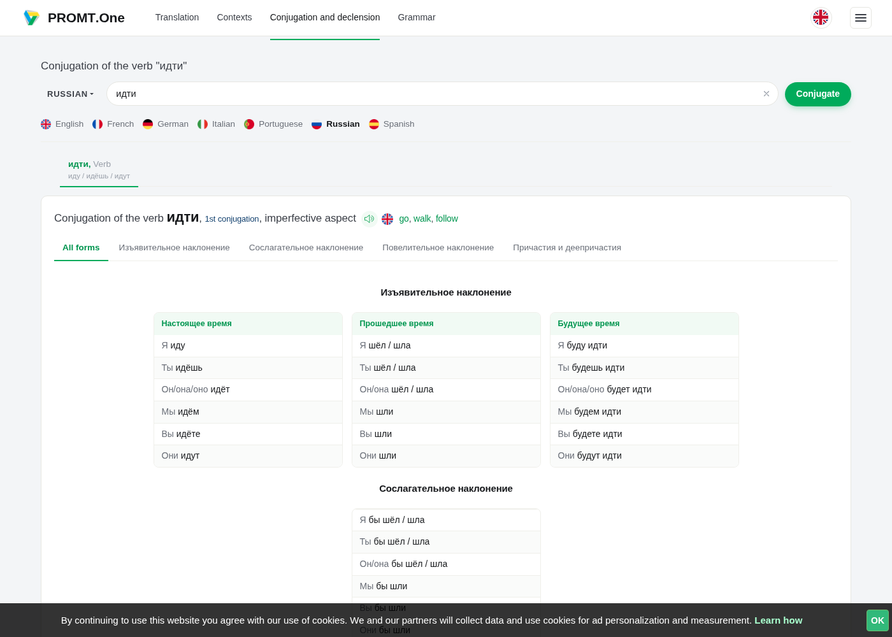
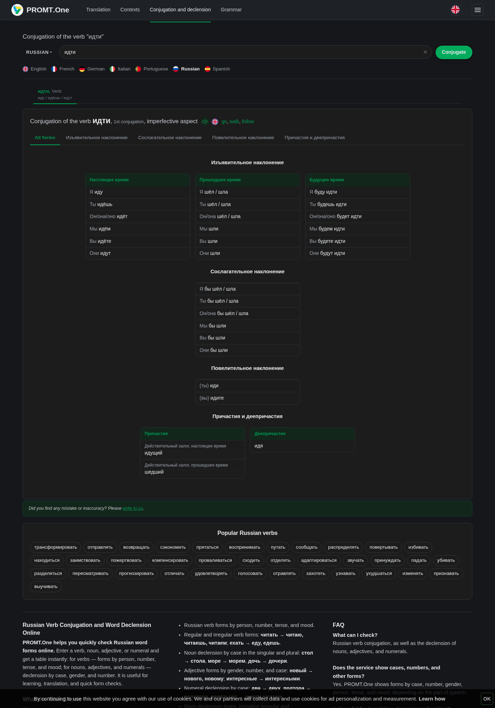

# PROMT.One Dark

A dark theme for [online-translator.com](https://www.online-translator.com) (PROMT.One translator, dictionary and conjugation tables). The site has no dark mode of its own, and generic tools like Dark Reader guess colours at runtime. This theme is generated from the site's own CSS instead, so every rule that sets a colour gets a matching dark override.

- Applied before the page renders: no white flash.
- Plain static CSS: nothing analysing the page while you use it.
- Keeps the PROMT green for buttons and dictionary highlights.
- Covers the translator, dictionary/examples, conjugation and declension tables, header, footer and banners.

| Before | After |
|---|---|
|  |  |
|  |  |

## Install

Pick **one**:

- **Userscript** (Tampermonkey / Violentmonkey): open [`promt-dark.user.js`](https://raw.githubusercontent.com/Brenovskh/promt-dark/main/promt-dark.user.js) and click *Install*.
- **Stylus**: open [`promt-dark.user.css`](https://raw.githubusercontent.com/Brenovskh/promt-dark/main/promt-dark.user.css) and click *Install style*.

Both update automatically from this repository.

If you use Dark Reader, **turn it off for online-translator.com**, otherwise it darkens on top of the theme.

## How it's built

`tools/build.py` downloads the site's current CSS bundles, `tools/gen.py` walks every rule and remaps colours (light backgrounds to dark, dark text to light, vivid brand colours kept), and `tools/manual.css` holds hand-tuned variables and the few parts that are images. Both install files are produced from the same CSS.

```sh
python3 tools/build.py 1.0.1   # version number for the generated files
```

If the site gets redesigned and something shows up light, open an issue (a screenshot plus the page URL helps) or rerun the build.

---

**PT-BR:** tema escuro para o online-translator.com (PROMT.One), gerado a partir do próprio CSS do site. Instale o `.user.js` no Tampermonkey/Violentmonkey ou o `.user.css` no Stylus, e desative o Dark Reader nesse site.

## License

MIT
